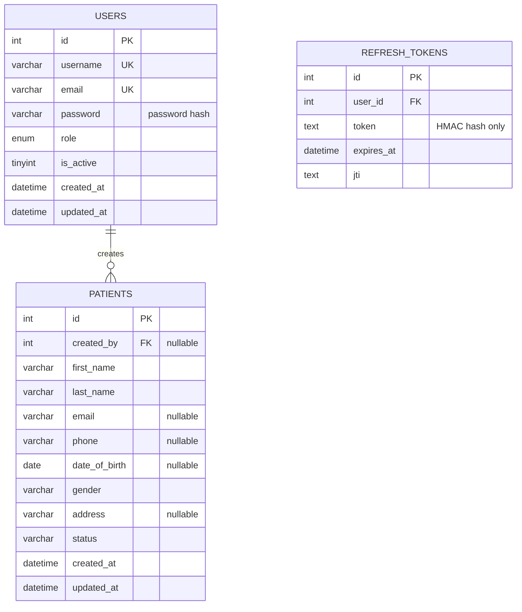

# MediCare+ System Design and Local Demonstration

## Project scope

MediCare+ is a clinic-management prototype with a patient portal and role-based clinic workspace. The Vue frontend and LavaLust API store appointments, patient profiles, treatment records, dentist schedules, services, payments, prescriptions, messages, clinic settings, notifications, and audit activity in MySQL. Admins manage clinic configuration; staff manage day-to-day records; patients manage their own appointments and payments.

This is an educational local-development project, not a production clinical record system. Use fictional records only. Prescription entries and dental chart conditions are administrative records and do not provide medical advice or diagnosis.

## Major requirements and functions

- Staff sign-in with hashed passwords and short-lived JWT access tokens.
- Role-checked API access: active users can read; administrators can create, edit, and delete patient records.
- Patient directory with search, record detail, create, update, delete confirmation, and empty/error/loading states.
- Server-side validation for names, email, date of birth, gender, status, and field lengths.
- A database health endpoint and migration for the `patients` table.
- Responsive navigation between dashboard, patient list, and patient detail.
- Appointment booking and status management, dentist schedules, treatment records, and an editable 32-tooth FDI chart.
- Billing and payment verification, prescriptions, clinic inbox messages, persisted clinic settings, reports, and notification/audit logs.

## Sitemap and navigation

```text
Sign in (/login)
  └── Dashboard (/)
       └── Patients (/patients)
            ├── New patient (form on /patients)
            ├── Patient detail (/patients/:id)
            └── Edit patient (form on /patients)
```

Unauthenticated users are redirected to `/login`. Signing out clears the local session and returns to `/login`.

## Initial interface wireframes

### Sign in

```text
+------------------------------------------------+
| MediCare+                                       |
|                                                |
|                 Staff sign in                 |
|       Username or email [________________]     |
|       Password          [________________]     |
|                       [ Sign in ]              |
|       Error/validation feedback                |
+------------------------------------------------+
```

### Dashboard

```text
+------------------+----------------------------------------+
| MediCare+        | Dashboard                    [Sign out] |
| Dashboard        |----------------------------------------|
| Patients         | Welcome back                            |
|                  | [Total patients] [Active] [Inactive]   |
|                  | Recent patients                         |
|                  | Name | Patient status | Added           |
|                  |                         [View directory] |
+------------------+----------------------------------------+
```

### Patient directory and record form

```text
+------------------+----------------------------------------+
| Dashboard        | Patients             [ + Add patient ] |
| Patients         | [ Search name / email / phone_______ ] |
|                  | Name | Contact | Status | Actions       |
|                  | ...                                  ... |
|                  |                                        |
|                  | Add / edit form:                      |
|                  | First name* [________] Last name* [___]|
|                  | Email [____________] Phone [__________] |
|                  | DOB [________] Gender [select]          |
|                  | Address [___________________________]   |
|                  | Status [active/inactive] [Save] [Cancel]|
+------------------+----------------------------------------+
```

### Patient detail

```text
+------------------+----------------------------------------+
| Dashboard        | Patients / Patient details  [Edit]     |
| Patients         | Patient name                 [Delete]   |
|                  | Status: Active                         |
|                  | Contact | Date of birth | Gender        |
|                  | Address                                |
|                  | [Back to patients]                     |
+------------------+----------------------------------------+
```

## Database design



`users` and `refresh_tokens` are defined by migrations `001` and `002`; deleting a user cascades to their refresh-token records. Migration `003` creates `patients`; `patients.created_by` references `users.id` and becomes null if the staff account is removed. Migration `005` repairs an absent patients table if the migration history says it ran but the table was removed. Patient queries use bound parameters. Passwords are stored with PHP `password_hash`; refresh-token records store an HMAC rather than the raw token.

| Table | Primary key | Important fields | Relationships |
|---|---|---|---|
| `users` | `id` | `username`, `email`, `password`, `role`, `is_active` | One user may create many patients |
| `refresh_tokens` | `id` | `user_id`, hashed `token`, `expires_at`, `jti` | Many refresh tokens belong to one user |
| `patients` | `id` | names, contact, DOB, gender, address, status, timestamps | `created_by` references `users.id` |

## Local setup

Requirements: PHP 8+, PDO MySQL, MySQL, and Node.js 22+.

1. Configure the backend `.env` database values. Keep `.env` private; it is ignored by Git. The supplied Aiven CA is saved at `app/config/certs/aiven-ca.pem` and selected by `DB_SSL_CA`; server certificate verification is enabled. Replace it with the CA for your database provider if needed. Use `php lava jwt:generate` if JWT secrets need to be generated or rotated.
2. From the backend folder, run migrations from the CLI:

   ```powershell
   php public\index.php __migrate
   ```

3. Create the initial admin interactively:

   ```powershell
   php console\create_admin.php
   ```

   Use a unique username/email and a password of at least 12 characters.
   For a local demo only, `php console\create_demo_account.php` creates or rotates the reserved demo admin and prints its randomly generated password once. This command requires `APP_ENV=development`.
4. Optionally run the disposable CRUD integration check. It creates a random test admin and fictional patient record, exercises login/create/read/update/validation/delete through the API, and removes its test rows:

   ```powershell
   php console\test_patient_crud.php
   ```
5. Start the LavaLust API with the local router. It applies the local MySQL settings before the remote `.env` is loaded:

   ```powershell
   php console\migrate_legacy_local.php
   php -S 127.0.0.1:8082 -t public router_local.php
   ```

   For the legacy local XAMPP database, run the migration once before starting the API. It preserves the original patients, dentists, appointments, and treatments as `legacy_*` tables, migrates compatible accounts and records, and leaves invoices and dentist slots intact. The local router uses the XAMPP `root` account with no password and does not modify `.env`. The migration can be safely run again after success.

6. In the frontend folder, install dependencies once and start Vite:

   ```powershell
   npm install
   npm run dev
   ```

   Open the URL printed by Vite (normally `http://localhost:5173`). Vite proxies `/api` requests to the local LavaLust server.
7. Sign in with the admin account created in step 3. Use fictitious data for demonstrations.

The API health check is `GET /api/health`; it verifies the configured database connection. The endpoint returns no credentials.

## API routes

| Method | Route | Access | Purpose |
|---|---|---|---|
| `POST` | `/api/auth/login` | Public, rate-limited | Exchange staff credentials for JWT tokens |
| `GET` | `/api/health` | Local status | Check database connectivity |
| `GET` | `/api/patients` | Active staff JWT | List patient records |
| `GET` | `/api/patients/{id}` | Active staff JWT | View one patient |
| `POST` | `/api/patients` | Admin JWT | Create a patient |
| `PUT` | `/api/patients/{id}` | Admin JWT | Validate and update the selected patient |
| `DELETE` | `/api/patients/{id}` | Admin JWT | Delete the selected patient |

Validation errors return HTTP `422` with field-specific errors; missing records return `404`; unauthenticated requests return `401`; unauthorized writes return `403`. The CLI-only migration route is rejected for web requests.

## Demonstration checklist

1. Show this design document's sitemap, wireframes, and ERD.
2. Run the migration and show the `users`, `refresh_tokens`, and `patients` tables.
3. Start both local servers and show the successful `/api/health` result.
4. Sign in, show patient records retrieved from the database, and navigate from dashboard to list and detail.
5. Create a fictional patient, edit that same record, and confirm the saved values.
6. Submit an invalid date/email or omit a required name and show server validation.
7. Confirm and delete the selected record, then verify it is gone from the database-backed list.
